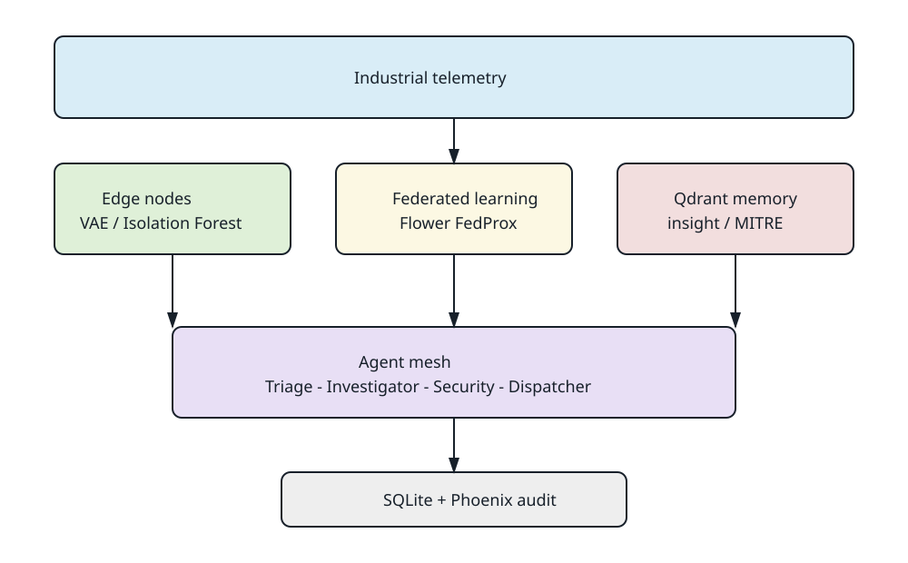

# Decentralized Agentic Mesh

Privacy-preserving industrial anomaly detection with local edge inference, federated
learning, and an authenticated LangGraph investigation workflow.

## Architecture

The local development build uses VAE and Isolation Forest detectors at the edge,
Flower FedProx simulation for aggregation, embedded Qdrant for insight/MITRE retrieval,
SQLite for audit metadata, an asyncio message bus, local Ollama inference, and optional
Phoenix tracing.



The complete Week 16 evidence package is documented in
`Documents/WEEK16_IMPLEMENTATION_AND_RESULTS.md` and operational instructions are in
`HANDOFF.md`.

## Prerequisites

- Python 3.12
- 8 GB RAM development machine
- Dependencies from `requirements.txt` and `requirements-dev.txt`
- Optional Ollama and Phoenix services for real-agent traces

## Quick start

```powershell
$py = '.\\agentvenv\\Scripts\\python.exe'
& $py -m pytest tests/unit -q
& $py -m scripts.run_local_stack --count 5 --metrics-path logs/metrics.jsonl
```

For a new environment:

```powershell
python -m venv agentvenv
.\\agentvenv\\Scripts\\python.exe -m pip install -r requirements.txt -r requirements-dev.txt
```

## Evaluation

```powershell
& $py -m evaluation.harness
& $py -m evaluation.chaos_test
& $py -m evaluation.ragas_eval
& $py -m evaluation.plot_metrics
& $py -m evaluation.check_success_criteria
```

The final checker is evidence-gated and currently reports `PASS_WITH_GAPS` until final
FL AUROC/F1, cumulative epsilon, and resource benchmark artifacts are captured.

## Repository structure

- `edge/`: local inference, preprocessing, models, and telemetry
- `federated/`: Flower simulation, strategies, convergence, and MLflow callbacks
- `agents/`: authentication, LangGraph workflow, security KB, and dispatch
- `evaluation/`: Week 14/15 harnesses and Week 16 final report gates
- `docs/architecture/`: Mermaid sources and SVG architecture exports
- `scripts/`: operational utilities
- `tests/`: unit and integration tests

Industrial datasets, model binaries, credentials, runtime databases, Qdrant stores,
logs, and generated dashboard PNGs are excluded by `.gitignore`. Use DVC for dataset
lineage rather than committing telemetry to Git.
